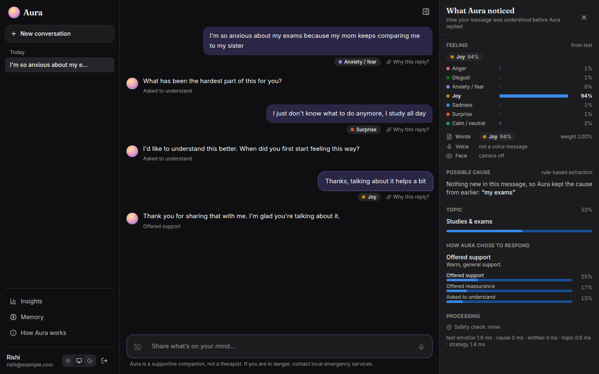
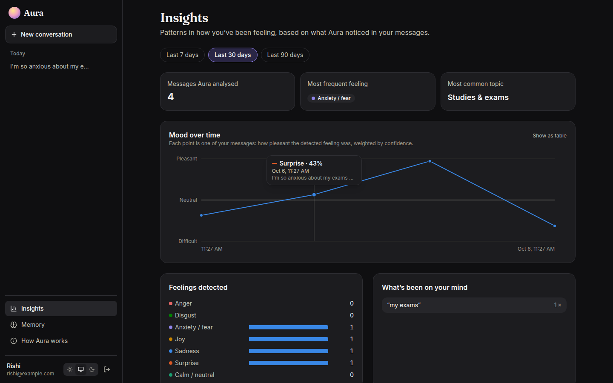
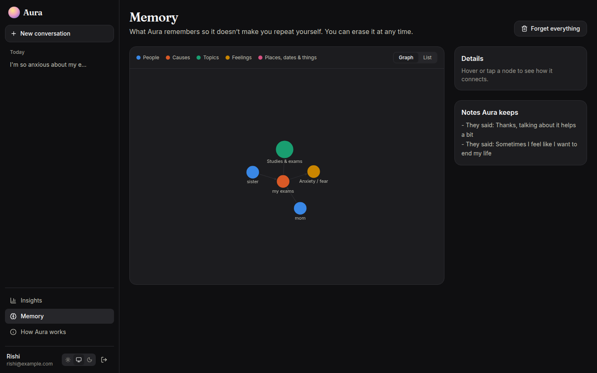
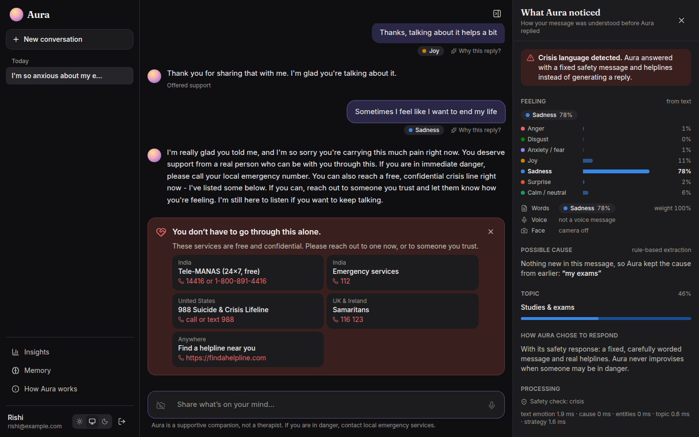
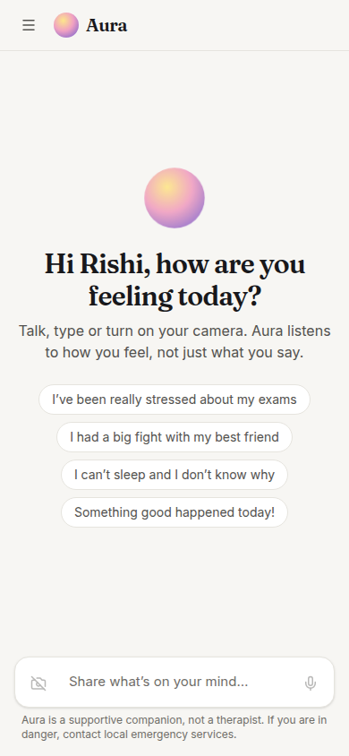
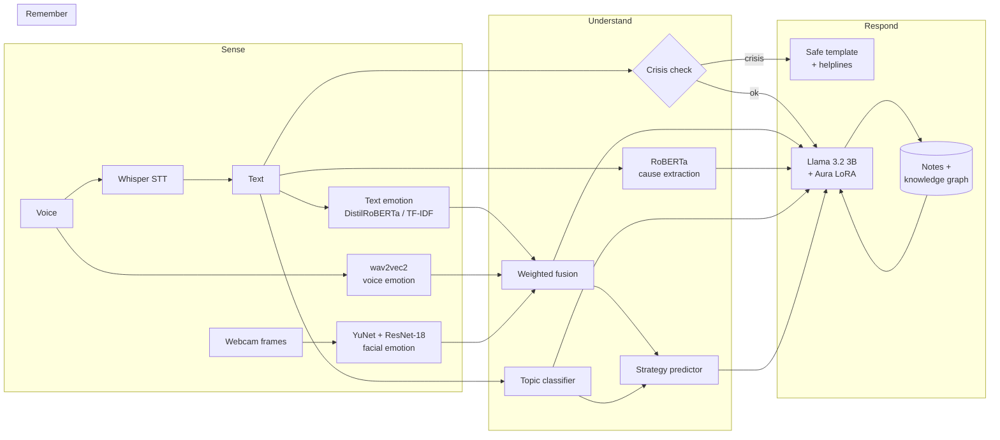

<div align="center">


# Aura

**A multimodal emotional-support companion that listens to *how* you feel, works out *why*, and shows its reasoning.**

[](https://github.com/krish1809/aura-ai/actions/workflows/ci.yml)




</div>

Most chatbots only see the words you type. Aura also listens to your voice and (if you allow it) looks at your
expression. It finds the *cause* behind a feeling in your own words, picks a support strategy the way a trained
listener would, and replies with a fine-tuned Llama 3.2. Every reply comes with a **"Why this reply?"** panel that shows
exactly what Aura perceived. It also has a crisis-safety layer, insights over time, and a personal memory that you can
inspect and erase.

## Features

- **Talk, type or show your face.** Whisper speech-to-text, a wav2vec2 voice-emotion model and a ResNet-18 facial-emotion model are fused with text emotion into one reading.
- **Finds the cause.** A two-head RoBERTa model extracts the span in your message that explains the feeling, and Aura carries it through the conversation.
- **Chooses how to help.** A strategy model picks one of the 8 ESConv support strategies (ask, reflect, reassure, suggest…) and conditions the LLM on it.
- **Explains itself.** For every message you can see the fused emotion, each modality's view, the highlighted cause, the topic, the chosen strategy and its alternatives.
- **Remembers, transparently.** A personal knowledge graph (people → causes → feelings → topics) plus short LLM-written notes, all viewable and erasable.
- **Safe by design.** Crisis language bypasses the LLM entirely: Aura replies with a fixed, carefully worded message and real helplines.
- **Runs anywhere.** *Lite mode* needs no GPU (CPU models, rules, demo replies); *full mode* loads the trained GPU models.

<table>
<tr>
<td></td>
<td></td>
</tr>
<tr>
<td></td>
<td align="center"></td>
</tr>
</table>

## How it works



Each message runs **Sense → Understand → Respond → Remember**. The LLM was fine-tuned with *the same prompt template the
app uses at inference*: perceived emotion, cause, topic, people mentioned, memory and the chosen strategy. That is what
lets it use this context instead of ignoring it. Details are in [docs/ARCHITECTURE.md](docs/ARCHITECTURE.md).

## Results

All numbers are measured on held-out test data and written to `artifacts/*/metrics.json` by the training scripts. The
app's *How Aura works* page shows them live.

| Model | Data / protocol | Test result | Baseline |
|---|---|---|---|
| Text emotion (CPU, TF-IDF + LR) | GoEmotions → 7 emotions | **64.2%** acc · **58.7%** macro-F1 | keyword lexicon: 30.8% macro-F1 |
| Support-strategy predictor | ESConv, 8 strategies | **31.0%** acc · 22.8% macro-F1 | majority 16.5% · repeat-previous 22.0% |
| Topic classifier | ESConv, 6 topics | **68.6%** acc · 62.5% macro-F1 (76% after 5 user turns) | n/a |
| Emotion-cause extraction (RoBERTa) | ESConv, silver labels | *pending GPU training* | n/a |
| Voice emotion (wav2vec2) | RAVDESS, unseen speakers | *pending GPU training* | n/a |
| Facial emotion (ResNet-18) | FER2013 PrivateTest | *pending GPU training* | n/a |
| Reply LLM (Llama 3.2 3B + LoRA) | ESConv test replies | *pending GPU training* (perplexity vs base) | base model |

Strategy prediction on ESConv is a hard task: published systems report roughly 28–32% accuracy. See
[docs/RESULTS.md](docs/RESULTS.md) for per-class results and how this version differs from the 2025 prototype.

## Quick start

### Docker (one command)

```bash
cp .env.example .env          # set AURA_JWT_SECRET to a long random string
docker compose up --build     # open http://localhost:8000
```

This starts Postgres and one container that serves the API and the web app in lite mode.

### Local development

Needs Python 3.11+, [uv](https://docs.astral.sh/uv/) and Node 22+.

```bash
uv sync                                   # Python workspace (ml + backend)
cd frontend && npm install && cd ..

make api      # FastAPI on :8000 (SQLite, lite mode)
make web      # Vite on :5173, proxies /api to :8000
make test     # 48 backend + ML tests
```

### Full mode (trained GPU models)

Train or download the models ([docs/TRAINING.md](docs/TRAINING.md)), then:

```bash
uv sync --extra inference                 # torch, transformers, peft, ...
AURA_ML_MODE=full AURA_LLM_PROVIDER=local make api
```

You can also serve the merged Aura model with Ollama and use `AURA_LLM_PROVIDER=openai`.

## Project structure

```
aura-ai/
├── ml/                 aura_ml: data pipelines, models, training, evaluation
│   └── src/aura_ml/    data/ (ESConv, causes, BIO, SFT set) · models/ · training/ · pipeline.py · prompts.py · safety.py
├── backend/            aura_api: FastAPI, WebSocket orchestrator, auth, memory, Alembic
├── frontend/           React 19 + Vite + Tailwind web app
├── artifacts/          trained models (small CPU models are versioned; GPU models are not)
├── docs/               architecture, training runbook, results
└── docker-compose.yml  Postgres + app
```

## Tech stack

**ML:** PyTorch, Transformers, PEFT/QLoRA (Unsloth), scikit-learn, spaCy, OpenCV · **Backend:** FastAPI, WebSockets,
SQLAlchemy 2 (async), Alembic, PostgreSQL/SQLite, JWT · **Frontend:** React 19, TypeScript, Vite, Tailwind CSS 4,
react-force-graph · **Ops:** Docker, GitHub Actions, uv.

## Responsible use

Aura is a supportive companion, **not a therapist**, and its models can be wrong. Crisis language is caught by a
transparent pattern list and answered with a fixed message and helplines (Tele-MANAS 14416 in India, 988 in the US,
Samaritans 116 123 in the UK/Ireland, or [findahelpline.com](https://findahelpline.com)). Webcam frames and voice
recordings are processed in memory and never stored. Users can erase Aura's memory or delete their account at any time.

## Acknowledgments

Aura began as a course project at IIT Bhilai with **Rahul Raj** (2025). This repository is a ground-up rebuild by
Rishi Kharya. It is built on [ESConv](https://github.com/thu-coai/Emotional-Support-Conversation) (Liu et al., 2021),
[GoEmotions](https://github.com/google-research/google-research/tree/master/goemotions) (Demszky et al., 2020),
[RAVDESS](https://zenodo.org/records/1188976) (Livingstone & Russo, 2018), FER2013, Whisper, wav2vec 2.0, RoBERTa and
Llama 3.2. Each dataset and model keeps its own license; check them before any commercial use.

## License

[MIT](LICENSE) © 2026 Rishi Kharya
